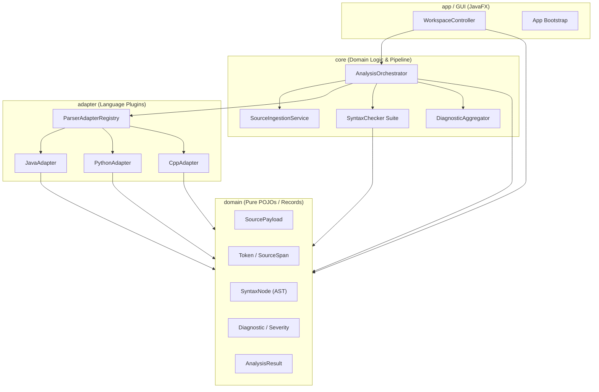
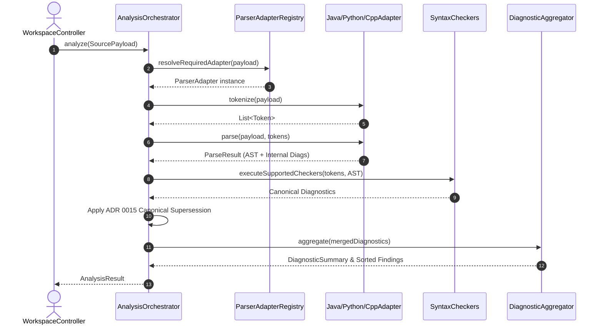

# Writely: Multi-Input Syntactical Analyzer
## High-Density Architectural Walkthrough & Code Deconstruction Pipeline

**Focus Areas:**
- Clean Architecture Boundaries & Module Seams
- End-to-End Pipeline: Lexing → AST → Universal Checking → Orchestration → GUI
- Polymorphic Language Adapters & Multi-Language Contrast
- Architectural Tradeoffs & Resilience Strategies

<!--
Presenter Notes:
Welcome everyone. Today we are walking through the architecture of Writely, a static syntax analyzer supporting Java, Python, and C++.
Instead of treating compilers and syntax analyzers as black-box monolithic engines, we will unpack how clean architectural seams decouple ingestion, language-specific parsing, universal syntax rules, orchestration, and responsive GUI rendering.
Target timeline: ~15 to 20 minutes across 15 high-density slides.
-->

---

## Slide 2: Architectural Boundaries & Module Seams

Writely follows **Clean / Ports-and-Adapters** architectural principles:



<!--
Presenter Notes:
Notice the dependency arrows. Everything points inward toward the 'domain' package.
1. 'domain' contains zero third-party framework dependencies. It's composed of pure immutable records and enums: Token, SyntaxNode, Diagnostic, AnalysisResult.
2. 'adapter' implements language parsing (Java, Python, C++).
3. 'core' orchestrates the pipeline and houses language-agnostic syntax checkers.
4. 'app' is the outer delivery mechanism (JavaFX GUI). If we swapped JavaFX for a CLI or web server tomorrow, zero lines in 'core', 'adapter', or 'domain' would change.
-->

---

## Slide 3: The Universal Seam — `ParserAdapter`

The bridge between language-agnostic orchestration and language-specific grammars:

```java
public interface ParserAdapter {
    Language language();
    List<Token> tokenize(SourcePayload payload);
    ParseResult parse(SourcePayload payload, List<Token> tokens);
    RuleCapabilities ruleCapabilities();
}
```

* **Contract Isolation**: The engine never branches on language types (`if (lang == JAVA)`).
* **Decoupled AST Output**: `ParseResult` emits `Optional<SyntaxNode>` and internal parser errors.
* **Declarative Capabilities (`RuleCapabilities`)**: Each adapter declares which universal rule categories it supports (e.g., Python opts out of `STATEMENT_TERMINATOR` semicolons).

<!--
Presenter Notes:
This interface is the crown jewel of Writely's extensibility.
The Orchestrator interacts solely with `ParserAdapter`.
When adding a new language like Rust or Go, developers only implement this single interface and register it in `ParserAdapterRegistry`.
Key design pattern: Strategy Pattern combined with declarative capability tagging.
-->

---

## Slide 4: Phase 1 — Ingestion & Source Normalization

Raw inputs enter through `SourceIngestionService` before touching any lexer.

* **Three Input Modalities**:
  1. `Single Line`: Immediate single-statement inspection.
  2. `Code Snippet`: Unsaved multiline scratchpad buffers.
  3. `File Upload`: Disk-backed files via file picker or tree explorer.
* **Normalization Responsibilities**:
  * Enforces UTF-8 character encoding.
  * Normalizes heterogeneous line separators (`\r\n` / `\r` → `\n`).
  * Emits an immutable `SourcePayload(content, language, inputMode, origin)`.
* **Zero-Leakage Seam**: Downstream tokenizers receive a guaranteed clean in-memory string with reliable line/offset mathematics.

<!--
Presenter Notes:
Why a dedicated ingestion service?
Different operating systems use different newline delimiters (\r\n vs \n). If line offsets were calculated on raw Windows files without normalization, character coordinates and column numbers reported in diagnostics would drift and highlight the wrong editor tokens. Ingestion normalizes early so downstream stages have mathematical consistency.
-->

---

## Slide 5: Phase 1 — Lexical Analysis & Token Channels

Tokenizers implement `Tokenizer` and break characters into atomic lexical tokens:

```
Source Code:   "int count = 42; // counter"
Emitted Stream: [KEYWORD: int], [IDENT: count], [OP: =], [INT_LIT: 42], [SEMI: ;], [COMMENT]
```

* **Trivia Channel Architecture**:
  * **Default Channel**: Significant program tokens (keywords, literals, identifiers, operators).
  * **Trivia Channel**: Comments, whitespace, indentation markers (`isTrivia() == true`).
* **Preserving Concrete Details**:
  * Parsers ignore trivia to keep ASTs concise.
  * Syntax checkers and editor syntax highlighters retain trivia to inspect comments, strings, and whitespace formatting without losing source coordinates (`SourceSpan`).

<!--
Presenter Notes:
Notice the difference between classic compiler lexers and IDE lexers.
A classic batch compiler discards comments and whitespace immediately.
An interactive analyzer cannot do that: if a user types an unterminated comment or leaves trailing whitespace, we must report diagnostics against it. Writely keeps trivia attached to tokens via boolean channel flags.
-->

---

## Slide 6: Multi-Language Tokenizer Contrast

Language semantics dictate unique lexical tokenization strategies:

| Feature | Java (`JavaTokenizer`) | Python (`PythonTokenizer`) | C++ (`CppTokenizer`) |
| :--- | :--- | :--- | :--- |
| **Delimiters** | Braces `{ }` emit blocks | Indentation stack emits `INDENT` / `DEDENT` | Braces `{ }` emit blocks |
| **Line Ends** | Newlines treated as whitespace | Newlines emit significant `NEWLINE` token | Newlines treated as whitespace |
| **Directives** | Annotations (`@Override`) | Decorators (`@property`) | Preprocessor `#include`, `#define` |
| **String Types** | Standard & text blocks `"""` | Single `'`, double `"`, triple `'''`, `f""` | Raw strings `R"(...)"`, wide `L"..."` |

<!--
Presenter Notes:
Here is where language differences emerge:
- Python is indentation-sensitive. Its lexer must maintain an indentation integer stack, generating synthetic INDENT and DEDENT tokens at line starts.
- C++ must tokenize preprocessor directives (#include, #define) as distinct tokens so downstream syntax checkers do not flag them as illegal operator usage (#).
- Java has distinct annotation tokens and multibyte character literals.
-->

---

## Slide 7: Phase 2 — Syntactic Parsing & AST Construction

Parsing transforms flat linear token streams into hierarchical syntax trees:

* **Separation of Concerns**:
  * `adapter.tokenize()` produces `List<Token>`.
  * `adapter.parse(payload, tokens)` constructs `Optional<SyntaxNode>`.
* **Two-Stage Error Handling**:
  * `ParseResult` captures structural syntax tree root.
  * Emits **Internal Parser Diagnostics** (e.g., `ERR_JAVA_MISSING_SEMICOLON`, `CPP_UNCLOSED_DELIMITER`) to facilitate parser error recovery without crashing the analysis run.
* **Fault-Tolerant Parse Trees**: Even if a syntax error occurs, the parser recovers and returns partial subtrees so the GUI still renders valid sections.

<!--
Presenter Notes:
A common pitfall in naive syntax analyzers is throwing an exception on the first syntax error and abandoning the tree.
Writely's adapters practice error recovery: they record an internal diagnostic, resynchronize at the next statement boundary (like a semicolon or newline), and continue parsing so the user gets feedback on the entire file, not just line 1.
-->

---

## Slide 8: AST Construction: `JavaAstMapper`

Deep-dive into Java AST translation:

```
[CompilationUnit]
  └── [ClassDeclaration: "Calculator"]
        └── [MethodDeclaration: "add"]
              ├── [Parameters: (int a, int b)]
              └── [Block]
                    └── [ReturnStatement]
                          └── [BinaryExpression: a + b]
```

* **50+ Typed AstNodes**: `JavaClassDeclaration`, `JavaMethodDeclaration`, `JavaIfStatement`, etc.
* **Recursive Tree Mapping**: Flat tokens are transformed into nested immutable `JavaAstNode` instances, then mapped to universal `SyntaxNode(type, label, span, children)`.
* **Span Preservation**: Every single AST node retains exact `SourceSpan(start, end)` coordinates to power interactive UI highlights.

<!--
Presenter Notes:
Look at `JavaAstMapper.java`. It converts raw parser events into strongly typed domain objects.
Every AST node knows its exact starting line/column and ending line/column.
This coordinate tracking is the critical seam that enables clicking an AST tree node in the UI and having the code editor instantly highlight the exact characters.
-->

---

## Slide 9: Multi-Language AST Structural Contrast

How language paradigms shape their corresponding AST hierarchies:

* **Java (`JavaCompilationUnit`)**:
  * Strict nominal hierarchy: Package → Imports → Classes/Interfaces/Records → Methods/Fields → Statements.
  * Strongly typed nodes with explicit parameter, variable, and return type nodes.
* **Python (`PythonModule`)**:
  * Script/module level statements permitted without enclosing class.
  * Indentation-driven block containers (`SuiteNode`) holding statements.
  * Dynamic assignments without type specifiers.
* **C++ (`CppTranslationUnit`)**:
  * Preprocessor directives (`CppInclude`, `CppPreprocessorDirective`) sit alongside declarations.
  * Namespaces (`CppNamespace`), Templates (`CppTemplate`), and header scope qualifiers (`std::`).

<!--
Presenter Notes:
Notice how the universal `SyntaxNode` record accommodates all three paradigms.
By defining `SyntaxNode` as: label, nodeType, sourceSpan, and children list, the GUI tree viewer can display Java classes, Python functions, or C++ templates using the exact same recursive TreeView renderer.
-->

---

## Slide 10: Phase 3 — Universal Rule Checking Suite

In addition to language parser errors, Writely executes 6 modular `SyntaxChecker`s:

1. **`DelimiterMatchingChecker`**: Stack-based validation of `()`, `[]`, `{}` pairs across tokens.
2. **`StringAndCharacterLiteralChecker`**: Unterminated quotes, illegal escape sequences.
3. **`StatementTerminatorAndBlockChecker`**: Missing `;` in Java/C++; improper indentation in Python.
4. **`OperatorSyntaxChecker`**: Illegal adjacent binary operators (`a ++* b`), missing operands.
5. **`ControlStructureHeaderChecker`**: Malformed `if (...)`, `for (...)`, `while (...)` condition headers.
6. **`IdentifierSyntaxChecker`**: Naming convention violations, invalid start characters.

* **Execution Guard**: Checked against `adapter.ruleCapabilities().supportedCategories()`.

<!--
Presenter Notes:
Why separate syntax checkers if the parser already checks syntax?
1. Clean code: Universal rules like delimiter balance and string termination work the exact same way across languages.
2. Rich actionable feedback: Checkers emit friendly repair suggestions (e.g. "Insert missing ';' at line 4").
3. Capability gating: Python adapters turn off statement terminator checks, while Java enables all six.
-->

---

## Slide 11: Phase 4 — Analysis Orchestrator Lifecycle



<!--
Presenter Notes:
Trace this sequence diagram carefully:
Step 1-3: Orchestrator resolves the adapter by file extension or language tag.
Step 4-7: Tokenize and parse execute within guarded try/catch blocks.
Step 8-9: Checkers run only for supported categories.
Step 10: Internal and canonical diagnostics are merged using ADR 0015 rules.
Step 11-13: Results are packaged into an immutable AnalysisResult and returned to the UI.
-->

---

## Slide 12: Phase 4 — ADR 0015 Canonical Supersession

**The Problem**: If a line is missing a semicolon, both `JavaParser` (internal) and `StatementTerminatorAndBlockChecker` (canonical) will flag it. Emitting both creates confusing UI duplicates!

```
Parser Diagnostic:    [JAVA_MISSING_SEMICOLON] "Syntax error on token, ';' expected"
Canonical Diagnostic: [ERR_MISSING_SEMICOLON]  "Missing statement terminator ';'" -> Fix: "Add ';'"
```

**The Resolution (ADR 0015)**:
* When an internal parser diagnostic and a canonical diagnostic share the same **`CheckCategory`** and **`SourceLocation` (line, column)**:
  * **Canonical supersedes Internal**.
  * The internal diagnostic is dropped; the canonical diagnostic with its actionable `suggestedFix` is retained.
* Ensures 100% deduplicated, clean diagnostic lists for the user.

<!--
Presenter Notes:
This is one of the most elegant architectural patterns in Writely: ADR 0015.
Instead of suppressing parser errors or weakening universal checkers, we run both and use an explicit deduplication policy:
Canonical diagnostics provide standardized error codes and actionable suggestions, so they win when pointing at the same category and line/column.
-->

---

## Slide 13: Phase 5 — GUI Decoupling & Reactive Rendering

How `WorkspaceController` processes `AnalysisResult` without blocking the JavaFX UI:

* **Background Worker Thread**:
  * Analysis runs inside JavaFX `Task<AnalysisResult>` via executor service.
  * Code editor typing remains responsive (60 FPS); UI never freezes during scans.
* **Main Thread Dispatch (`Platform.runLater`)**:
  * Upon task completion, results bind to UI controls:
  1. `renderTokens()`: Populates `TableView<Token>` and updates token search filter.
  2. `renderAst()`: Constructs recursive `TreeView<SyntaxNode>` nodes.
  3. `renderDiagnostics()`: Clears and repopulates `VBox` diagnostic cards.
  4. Header Status Banner & Footer metrics update atomically.

<!--
Presenter Notes:
UI thread hygiene is critical.
Never run lexing, parsing, or rule checking on the JavaFX Application Thread.
Writely launches a background Task, computes the AnalysisResult in worker threads, and dispatches UI updates back to the scene graph using Platform.runLater().
-->

---

## Slide 14: Phase 5 — Diagnostics Cards & Interactive Caret Jump

From Diagnostic Data Model to Interactive UI Element:

```java
// Inside WorkspaceController.createDiagnosticCard()
VBox card = new VBox(6);
card.getChildren().addAll(headerBadges, messageLabel, fixLabel);

card.setOnMouseClicked(ev -> {
    jumpToLocation(diag.line(), diag.column());
    highlightLine(diag.line(), diag.column());
});
```

* **Visual Hierarchy**: Severity Pill (`ERROR`/`WARNING`) + Error Code + Location Badge + Category Pill.
* **Coordinate Mapping Seam**:
  * Editor uses raw character offsets (`text.charAt(i)`).
  * Diagnostics use 1-based `line` and `column`.
  * `locationToOffset(line, column)` translates coordinates to text caret index and selects the offending character span.

<!--
Presenter Notes:
Here you see the full circle of the pipeline:
The user types code -> Ingested -> Tokenized -> Parsed into AST -> Checked -> Aggregated -> Rendered as a styled diagnostic card.
When the user clicks the card, the exact reverse mapping happens: Line and column are translated to character offsets, focusing the editor caret on the error!
-->

---

## Slide 15: Key Design Tradeoffs & Architectural Summary

| Tradeoff | Selected Approach | Rationale & Alternative Rejected |
| :--- | :--- | :--- |
| **Storage Model** | 100% In-Memory Pipeline | Rejected disk serialization/caching for maximum speed and simplicity (ADR 0001). |
| **AST Representation** | Lightweight `SyntaxNode` + typed records | Rejected heavy compiler frameworks (ANTLR/Eclipse AST) to eliminate bloat and maintain zero runtime baggage. |
| **Pipeline Resilience** | Fault-Tolerant Stage Containment | Never throws on parse error; converts failures to `ERR_INTERNAL_CHECK_FAILURE` diagnostics. |
| **Diagnostic Model** | Two-Tier Canonical Supersession | Internal parser recovery diagnostics cleanly yield to actionable canonical rules (ADR 0015). |
| **Language Extensibility** | Declarative `RuleCapabilities` | Avoids scattered `if/else` language checks; each adapter declares supported scopes cleanly. |

<!--
Presenter Notes:
To conclude: Writely proves that complex language tooling does not require monolithic architecture.
By designing clean seams between tokenization, AST generation, rule checking, and UI presentation, the codebase achieves:
1. High testability (each checker and adapter is unit tested in isolation).
2. Frictionless extensibility (adding a new language requires zero changes to core).
3. Rock-solid stability (pipeline stages never crash the UI).
Thank you! Opening the floor for questions.
-->
